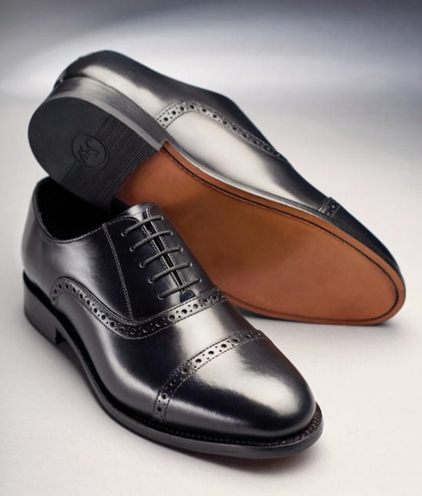
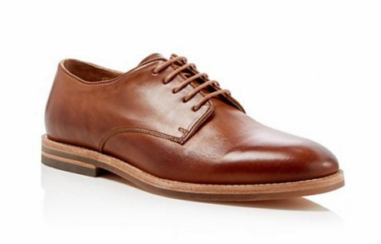
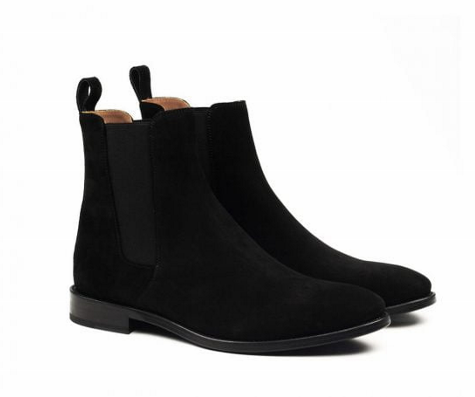

# Các loại giày nên có

## Giày Oxford đen

Đôi giày không thể thiếu khi bạn được yêu cầu ăn mặc trang trọng, lịch sự.

Derby nâu dùng được khi đi làm, đi chơi cuối tuần, hẹn hò, và đi tiệc tùng, trừ lúc vào phòng gym. Chelsea boots mùa đông xỏ chân là xong, kiểu tối giản, và thường là đôi cuối khi chưa biết đi giày gì. Sneakers tối giản cho ngày thường, đi chơi, và đi làm nếu nơi đó cho phép casual. Nên giữ một hoặc hai đôi màu trắng, đen, xám, hoặc beige. Độ formal của sneakers thấp, nhưng chúng phối được với hầu hết các loại quần.

## Giày Derby nâu

Đôi giày có thể chinh chiến cùng bạn trong mọi mặt trận: đi làm, đi chơi cuối tuần, hẹn hò, tiệc tùng, v.v… Chỉ ngoài việc mang đi tập gym thôi, đôi Derby màu nâu luôn là khoản đầu tư xứng đáng!

## Chelsea boots

Hơi ngớ ngẩn một chút nhưng tôi luôn gọi Chelsea boots là đôi loafers của mùa Đông, tất cả những gì bạn cần làm là xỏ chân vào trong giày. Thiết kế “lười biếng”, tối giản chi tiết của Chelsea boots là mảnh ghép cuối cùng trong rất nhiều set đồ của tôi, khi câu hỏi đặt ra là “mặc như thế này xong nên đi giày gì?”.

## Sneakers thiết kế tối giản

Đôi giày thể thao không thể thiếu cho các hoạt động hàng ngày, đi chơi, đi làm (nếu môi trường cho phép casual). Nên chọn các thiết kế tối giản, màu sắc trung tính để dễ phối đồ.

- Độ formal: Thấp
- Độ linh hoạt phối đồ: Rất cao, phối được với hầu hết các loại quần
- Chất liệu: Thường là da tổng hợp, canvas, hoặc mesh
- Màu sắc: Trắng, đen, xám, beige là các màu dễ phối nhất
- Số lượng: 1-2 đôi

Sneakers thường làm từ da tổng hợp, canvas, hoặc mesh. Trắng, đen, xám, và beige là các màu dễ phối nhất của loại này. Derby nâu là khoản đầu tư xứng đáng cho đi làm, cuối tuần, hẹn hò, và tiệc, trừ khi mang đi tập gym. Ở đây Chelsea boots được gọi là loafers của mùa đông vì chỉ cần xỏ chân vào. Kiểu tối giản ấy là mảnh ghép cuối trong nhiều set đồ. Oxford đen giữ vai trò trang trọng và lịch sự.
