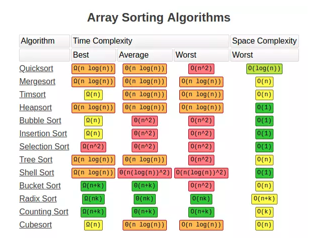

# Sorting Algorithms

This note is a comparison table, plus one link on linear-time sorting. The table's filled cells are the only claims here. Empty pros and cons cells stay empty.

Bubble Sort is listed for small arrays, with Big O of n^2. Insertion Sort is listed for small or nearly sorted arrays, also n^2. Heap Sort is marked not stable, with Big O of nlogn. Quick Sort is also marked not stable. Its Big O cell says nlogn, and it can fall back to n^2. RadixSort is listed for sorting integers. The table says it cannot sort real numbers. Its Big O cell says nlog of the max value. The see-also line points at Big O Notation and at Algo Arrays Searching Sorting. The overview bullet links a Viblo post on linear-time sorting. An image sits under the table. No other algorithms are listed.

## Overview

- Linear-time sorting: https://viblo.asia/p/sap-xep-voi-thoi-gian-tuyen-tinh-E1XVOZ6GLMz

## Comparing Sorting Algorithms

| Algorithm      | Use when                      | Pros / cons              | Big O           |
| -------------- | ----------------------------- | ------------------------ | --------------- |
| Bubble Sort    | Small arrays                  |                          | n^2             |
| Insertion Sort | Small or nearly sorted arrays |                          | n^2             |
| Heap Sort      |                               | Not stable               | nlogn           |
| Quick Sort     |                               | Not stable               | nlogn → n^2     |
| RadixSort      | Sorting integers              | Cannot sort real numbers | nlog(max value) |

> **See also:** [Big O Notation](/Technology/Algorithm/Concepts/Big O Notation) · [Algo Arrays Searching Sorting](/Technology/Algorithm/Resources/Algo Arrays Searching Sorting)
