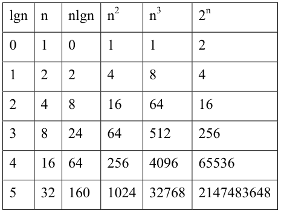

# Big O Notation

Big O notation in this note is the number of operations that must be performed as a function of input size. It is typically used to evaluate the worst case. The common notation written here is Theta of f of N.

Simplification keeps the highest-order term and drops constants. The example starts from f of N equals 2x squared plus 2x plus 2. The highest-order term is x squared. The constants are dropped, so the note reduces that function to x squared. The example writes the longer function as implying x squared.

Sorting Algorithms and Data Structures Overview are the related notes.

## Definition

- Definition: the number of operations that must be performed as a function of input size
- Typically used to evaluate the worst case
- Common notation: $\Theta(f(N))$
- Simplification: keep the highest-order term and drop constants (example)

$$
f(N)=2x^2+2x+2 \Rightarrow f(N)=x^2
$$

> **See also:** [Sorting Algorithms](/Technology/Algorithm/Concepts/Algorithms/Sorting Algorithms) · [Data Structures Overview](/Technology/Algorithm/Concepts/Data Structures/Data Structures Overview)
