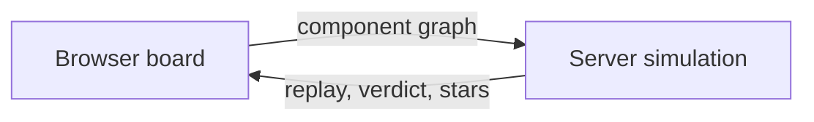

# GonnaCrash

[GonnaCrash](https://systemdesign.200lab.io/) is 200Lab's free system design game. The page describes it as building a system, sending traffic through it, finding where it crashes, and fixing it without going over budget. Checked 31 October 2026: the document title is "GonnaCrash · System Design Game", `og:site_name` is 200Lab, the page is Vietnamese unless `sdgame-locale` is `en`, and the default skin is Sketch (Soft is the other skin). The page is `noindex`.

This note is about that 200Lab game. [gonnacrash.com](https://gonnacrash.com/) uses the same product name and is a different host. Its how-to-play page offers Learn, Questions, and Sandbox, and its privacy policy (effective 18 October 2026, updated 24 October 2026) says that game runs at gonnacrash.com. Neither site, on the pages read here, says they share a backend. The 200Lab build article says the idea came from a friend and that Việt Trần rewrote the engine for 200Lab.

## How a round works

The browser is the board. You drag components on, connect them, and press Run. The client sends the design. The server simulates the traffic and returns the verdict. The motion on the board is a replay of that result, which is how the 22 October 2026 build article describes the scoring path. Leaderboards and stars are the reason the article gives for not letting the browser grade itself.

A level passes only when its rules pass. The article's worked example, level 5 of Foundations, "Cả nước lướt app giờ trưa", sends 1,800 reads and 200 writes a second at a few hot posts. Its stated goals are 99% of requests answered, average wait under 300 ms, and cost inside the budget. The client copy for the world map scores each level out of 3 stars. The article ties those stars to cost against the cheapest design its solver found: close to that cost is 3 stars, a bit more is 2, inside the budget is 1. Picking the largest size of everything is tested to earn no stars. The same article says there is no single correct diagram, only one that is enough for that traffic.

The client guide also says a repeat run of a design you have not changed is free, and that extra copies of one node are a Cluster on that node rather than more boxes drawn by hand.

## Worlds

The client ships four campaign keys and a short pitch for each. The build article says the game opened on the afternoon of 20 October 2026 with four worlds and 90 levels. On 31 October 2026, `GET https://api.200lab.io/v1/sdgame/worlds` and `GET https://api.200lab.io/v1/sdgame/catalog` returned Cloudflare 525 and then 502, so this note does not re-count the live catalog. The pitches below are the client's own strings. The "coming soon" list hides a campaign once the catalog contains its key, so these strings are the names, not proof that a world is still unreleased.

| Key | English title | Vietnamese title | Pitch in the client |
| --- | --- | --- | --- |
| `foundation` | Foundations | Nền tảng | One app grows from a handful of users to an exploding Black Friday |
| `high_load` | High-load systems | Hệ thống tải cao | A choking database and surging traffic: replicas, partitioning, sharding, queues, CDN, then multi-region |
| `ai_apps` | AI apps | Ứng dụng AI | Every token costs money: streaming, prompt caching, semantic cache, fallback and RAG |
| `agent_harness` | Agent Harness | Agent Harness | Agents run for minutes and call real tools: durable workflows, sandboxes, guardrails, quotas and a human approver |

The map UI speaks in chapters and bosses. A locked world names how many more stars it needs. A locked level can wait on the previous level, on a chapter boss, or on every other level in the chapter.

## What the article says the engine does

The numbers in this section are from [Việt Trần's build article](https://200lab.io/blog/game-system-design-gonnacrash-duoc-lam-nhu-the-nao), published 22 October 2026. They were not re-counted from the catalog, because that API was down.

The article's hard rule is that one design must produce the same result, byte for byte, on every machine. The engine counts with integers (time in microseconds, money in millionths of a cent), reads no clock, draws no random numbers, and does not run the step in parallel. Components are visited in a fixed order. A remainder is kept: 10 split three ways is 4, 3, 3. A test reads the engine source to block the banned operations. An identical design can be answered from the stored result. The article treats that determinism as the basis for the leaderboard, the star cutoffs, and the level tests, not as a speed trick.

A run is a sequence of ticks, up to 600. A tick is 1 second, 1 minute, or 3 minutes, depending on the level. Each tick applies an incident if one is due, admits traffic, loads each component, then computes how many requests were answered and how long they waited. Traffic is flows ("reads of the hot posts"), not one simulated user at a time, so 50 and 50,000 requests a second cost the same compute.

Content is YAML, so a new level does not require an engine change. The article's inventory is 41 component kinds, 76 traffic kinds, and 90 levels. The coded part is 29 Go behaviors (serve, forward, cache, rate-limit, call an LLM, run an agent). A new component is usually a mix of those behaviors. Each level file states what the level teaches, and the tests are supposed to prove that promise.

Grading uses 15 rule kinds (answered fraction, wait, budget, data loss, staleness, duplicates, whether an AI answer counts, and others). The first failed rule decides the loss. The engine then ranks components for drops, extra delay, or cost, and names the fault from a list of 112, specific before generic, so a loss always has a reason. The player sees the top cause plus up to three contributing causes, each pointing at a lesson.

The article names five behaviors it wants players to hit:

- More app servers without a load balancer still pile traffic on one server.
- Overload gets slow before it starts dropping work.
- A second cache of the same data does not hide a miss on the first.
- More components that call one LLM provider do not raise that provider's quota.
- A region or provider outage lasts for a span and then ends. A dead machine or a wiped cache is immediate and does not heal itself. The load balancer takes time to notice a dead machine.

## How levels are tested

The article says a correct engine is not enough, because a level can have a shortcut, can be too easy, can include an incident that changes nothing, or can fail the player for a reason other than the lesson. Each level goes through 14 automatic checks. The ones the article highlights:

| Check | Question |
| --- | --- |
| Reference solution and a wrong design | Does the reference pass, and does the wrong design fail for the intended reason? |
| Hide the lesson | If the thing the level wants to teach is forbidden, can the solver still pass cheaply? |
| Pick the largest of everything | Does that earn stars on its own? |
| Incidents matter | Does each incident change the result? |
| The lesson matches the failure | Is the player's fault the one the level set out to teach? |

A solver bot tries thousands of designs: add or remove components, rewire them, change size and count, and restart from many points. It prefers fewer failed rules, then lower cost. For a level that requires a cache, forbidding the cache must leave the bot with no pass. For a level where a cache only saves money, a pass without it must cost clearly more. If the bot beats the reference on cost, the reference is weak or the level has a hole. The article says a bot that finds no shortcut has not proved there is none, unless the level is small enough to enumerate. People and other agents still review.

Reference solutions and the wrong designs for all 90 levels have stored results. An engine change replays them and compares every byte except the engine version. Accepting a diff requires an explanation.

The article's authoring loop is: one agent drafts the level with a reference and a wrong design, a quick check runs, a second agent solves from the prompt alone, the full check runs and stores results, fixes stop after three rounds, and a person plays the level before it opens. The full check is heavy because each level is solved 20 times from 20 starts, so the article says that job was run on a separate PC.

Hints open in four steps as you lose: a direction, the mechanism with the arithmetic, how to trim a design that already passes, and the full answer. The article says level 7, "Đêm Hacker News", was where many players stuck, and that its hints were changed from open questions to concrete moves, including service clusters and a read replica.

## Build notes and the agent pack

The article also describes the Sketch skin: white paper, a dot grid, marker strokes, Excalidraw-like colors, Patrick Hand for titles (including Vietnamese diacritics), and ordinary text for the data lines. Icons are drawn once with rough.js and a fixed seed per component kind, then recolored for selected, hot, or crashed. A production bug: "View on board" replaced a design but reused node names `n1`, `n2`, and so on for different component kinds. The canvas library remembered ports by those names, so the new edges did not draw. The article says every action that replaces a design (open, preview, undo, paste) has to be tested with a design that reuses names and changes kinds.

The same page offers a 20.7 KB zip, "Bộ engine rules và skin Sketch của GonnaCrash", for someone who wants an agent to rebuild this kind of game on another stack. The article says the zip holds engine rules, Sketch CSS, and a Sketch guide, and that the files are not tied to 200Lab's framework. This note did not open the zip, so that file list is the article's description.

The public client routes observed on 31 October 2026 are `/`, `/worlds/$worldKey`, `/levels/$levelKey`, `/leaderboard`, and a shared-design route. The client's public API table names `GET /v1/sdgame/catalog`, `GET /v1/sdgame/worlds`, `GET /v1/sdgame/studio`, and `GET /v1/sdgame/designs/{shareId}` on `https://api.200lab.io`, with `locale` on the catalog and world lists. The content security policy allows the page's own scripts, Google Tag Manager, Google Analytics, `assets.200lab.io`, and GitHub avatar images. A consent object with `measurement` and `marketing` is stored in local storage and in a cookie scoped to `.200lab.io`. The client starts `startConfiguredSdgameAnalytics` after load. This note did not sign in and did not complete a level.

> **See also:** [Designing For Distributed Failure](/Technology/System Design/Concepts/Designing For Distributed Failure) · [System design fundamentals](/Technology/System Design/Practices/System Design Notes/Fundamentals) · [200Lab Blog](/Technology/Documentation/Resources/Tech Blogs And Books) · [Request Body Limit And Load Shedding](/Technology/System Design/Practices/Request Body Limit And Load Shedding)
